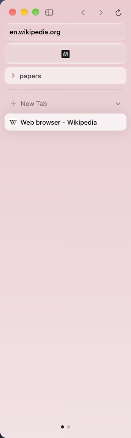
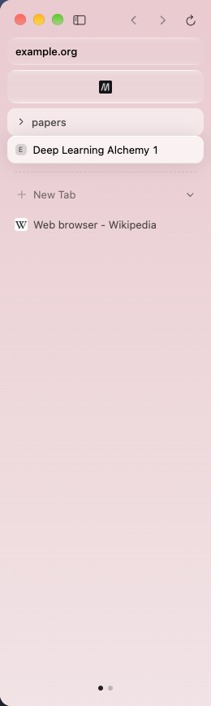
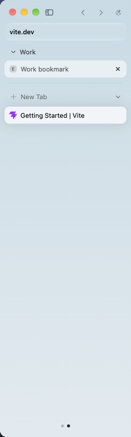
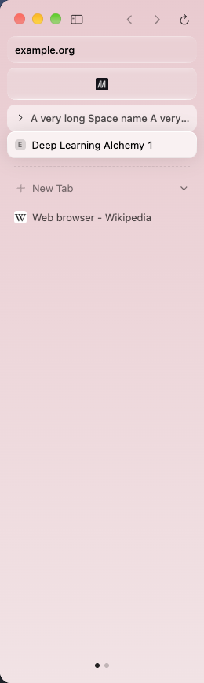

# Pinned-section disclosure

These are screenshots of the actual shared React UI in the local Ardia web demo, driven through Chromium. They use synthetic imported bookmarks and are cropped to the affected sidebar. They do not establish deployed or native macOS acceptance.

The reference recording's dark app is Arc; its light app is Ardia. Arc exposes a Space-name disclosure above its bookmarks. Ardia's existing fold control hid on hover in the divider below the pinned list, so a long import made it hard to reach. The bookmark import structure was already correct.

| Before: control below the long list | After: header above the bookmarks | After: collapsed |
| --- | --- | --- |
|  |  |  |

| Active pin stays reachable | Another Space stays expanded | Long names truncate |
| --- | --- | --- |
|  |  |  |

The before view serves `PageRows.tsx` and `ClearDivider.tsx` from baseline `8a07d45b4` through a Vite load override. The before and after use the same 1280×900 viewport, 260-point sidebar and fixture: 36 root pinned rows in papers, one root pinned row in Work, ordinary tabs, and one Top App.

To reproduce the after states, start the existing demo and run its browser check in another terminal:

```sh
pnpm -C packages/demo dev
CHROME_BINARY='/Applications/Google Chrome.app/Contents/MacOS/Google Chrome' node packages/demo/scripts/pinned-section-check.mjs 'http://127.0.0.1:5191/?bare' /tmp/ardia-pinned-section-check
```

Omit `CHROME_BINARY` when Playwright's bundled browser is installed. The check imports the fixture through `importArcSpace`, exercises pointer collapse, keyboard expansion, active-pin retention, Space isolation and long names, and records full-window PNGs. The header-placement assertion fails on the baseline.

Verification: browser and Linux typechecks; four Linux module-graph checks; 830 Linux host tests; 63 focused browser tests including conventions, geometry, fold state, import and telemetry; the demo production build; the rendered interaction check. An independent review found no actionable issues.

Native limitations: this Mac has Command Line Tools but no Xcode. A separate downloaded nightly ran hidden with copied data and exposed page CDP, but native window capture failed with `could not create image from window`; release builds do not expose the DEBUG-only snapshot API. Arc's additional scratch launch did not expose its requested CDP port, so the Arc reference is the supplied recording and a read-only copy of its sidebar data. The installed Ardia app and live profiles were not modified.

Telemetry extends `usage_counts` with consent-gated `pinned_section_collapses` and `pinned_section_expands`, reset when sharing is turned off. No names, URLs or page content are collected. Existing per-Space fold storage, import, group membership, pin URLs and active-tab behavior are reused.
